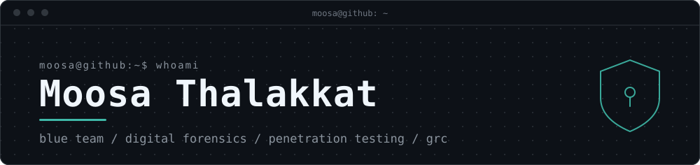

<div align="center">



<br>

<a href="https://moosatt.vercel.app"></a>
<a href="https://www.linkedin.com/in/moosa-t-b6b826325/"></a>


</div>

<br>

```text
~ $ cat about.txt

  BSc Cyber Security & Digital Forensics, First Class Honours
  Middlesex University Dubai

  base    Saudi Arabia / UAE
  status  open to SOC analyst, cybersecurity analyst,
          penetration testing and GRC roles
```

```text
~ $ ls focus/

  blue-team/   threat hunting, detection engineering, incident response
  forensics/   memory, disk and email analysis, ISO 27037 chain of custody
  red-team/    external black-box pen tests, severity-rated reporting
  grc/         ISO standards, consulting-style reporting
```

```text
~ $ cat tools.txt

  Nmap  Metasploit  Nikto  Gobuster  FFUF  theHarvester  WhatWeb
  Volatility  Autopsy  FTK Imager
```
