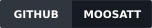
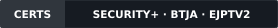
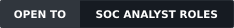

 

 

  

<h3><code>moosa@github ~ $ cat focus.txt</code></h3>

  

<h3><code>moosa@github ~ $ whoami</code></h3>
<table>
  <tr>
    <td valign="top"></td>
    <td valign="top"></td>
  </tr>
</table>

 

<h3><code>moosa@github ~ $ ./contributions.sh</code></h3>

  

<h3><code>moosa@github ~ $ ./snake.sh</code></h3>
<picture>
  <source media="(prefers-color-scheme: dark)" srcset="https://raw.githubusercontent.com/moosatt/moosatt/output/github-snake-dark.svg" />
  
</picture>

  

<code>BSc Cyber Security &amp; Digital Forensics · Middlesex University Dubai · First Class Honours</code>

